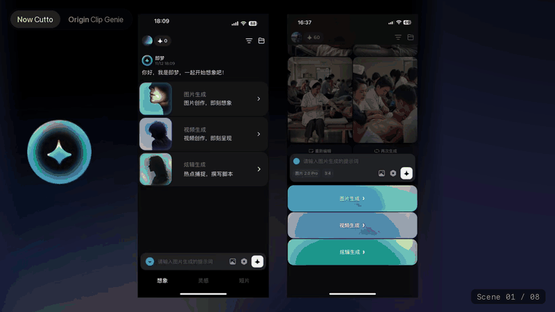
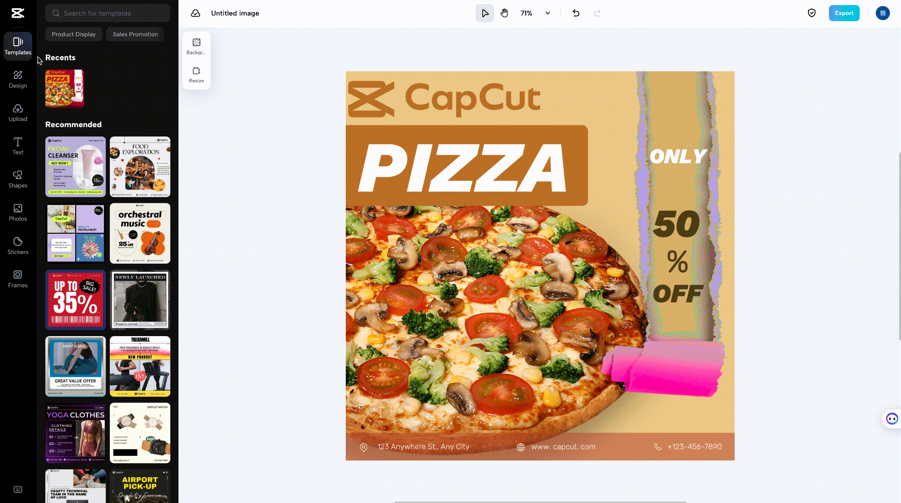
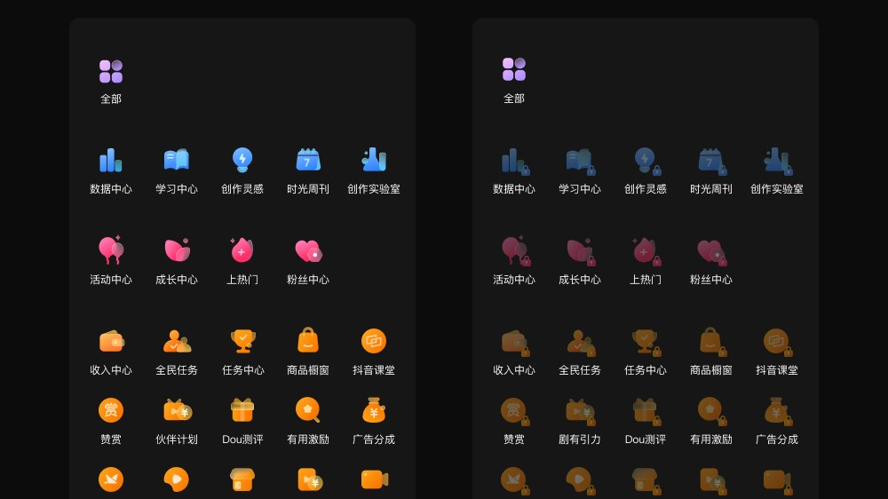

I'm a design lead with **12 years in UX**, now focused on **AX: the AI experience**.
Tools, design systems and 0→1 products across TikTok, CapCut, Xiaomi and Amap.
Designer, not an engineer — I file the bugs I hit.

### 🎬 Now · Cutto

An AI video storyboard tool, built 0 → 1. I lead design and run Cutto's X, Instagram and YouTube.

> How should an AI tool talk about pacing? Put the note beside the shots it is about, make it specific, and leave the cut to the creator.

### Selected work

<table>
  <tr>
    <td width="50%" valign="top">
      
       <b>Cutto</b> · AI video storyboard
       Design Lead · 0 → 1
    </td>
    <td width="50%" valign="top">
      
       <b>CapCut</b> · Web image editor
       Visual Design Lead · icon system, motion
    </td>
  </tr>
  <tr>
    <td width="50%" valign="top">
      
       <b>TikTok Creator Center</b> · A clearer path for creators
       Visual Design Lead · architecture, standards
    </td>
    <td width="50%" valign="top">
      
       <b>Design System</b> · Consistency, built into the details
       Design System Owner &amp; Visual Lead · foundations, navigation, icons
    </td>
  </tr>
</table>

### 🧰 Claude skills I built

| Skill | What it does |
| --- | --- |
| [**say-less**](https://github.com/josiezhangruo/say-less) | Translates engineering jargon into design implications. For designers, in any language. |
| [**superstar-influencer**](https://github.com/josiezhangruo/superstar-influencer) | One post from idea to review: structure, cover, multi-platform package, data loop. |
| [**max-ctr**](https://github.com/josiezhangruo/max-ctr) | A reusable system for high-CTR video and social covers. |

### Say hi

&nbsp;Open to AI product design and design leadership roles.
