<a href="https://cutto.ai">cutto.ai</a> &nbsp;·&nbsp; <a href="https://x.com/josie_zhangruo">@josie_zhangruo</a> &nbsp;·&nbsp; Open to AI product design and design leadership roles

Skills I built

